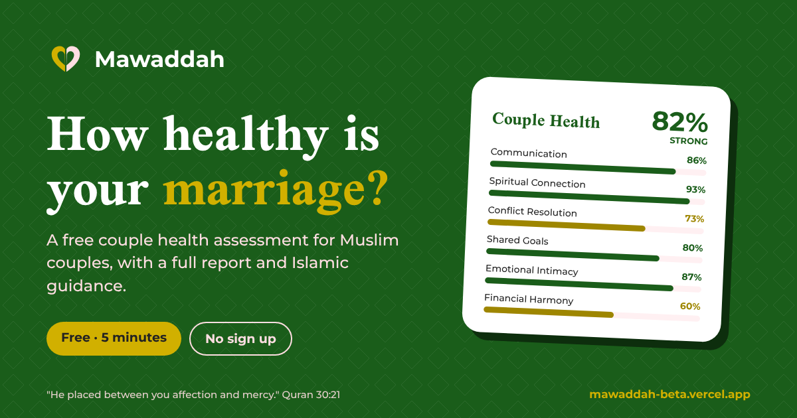
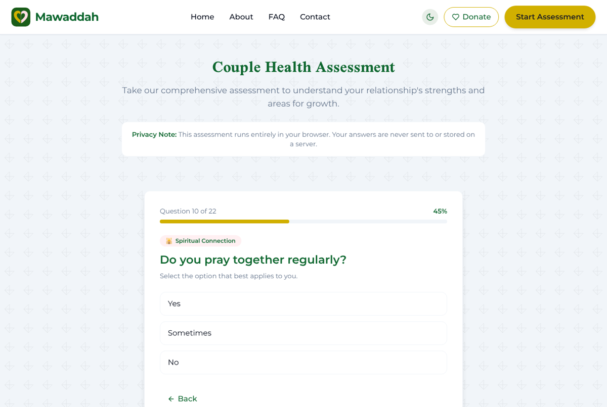
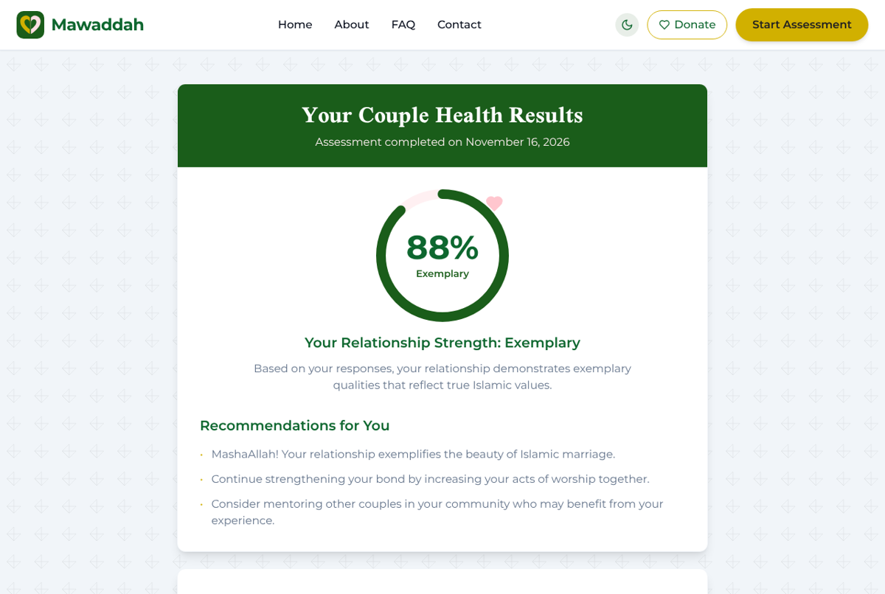
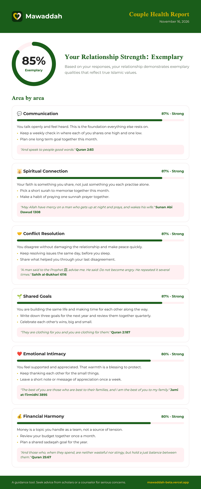
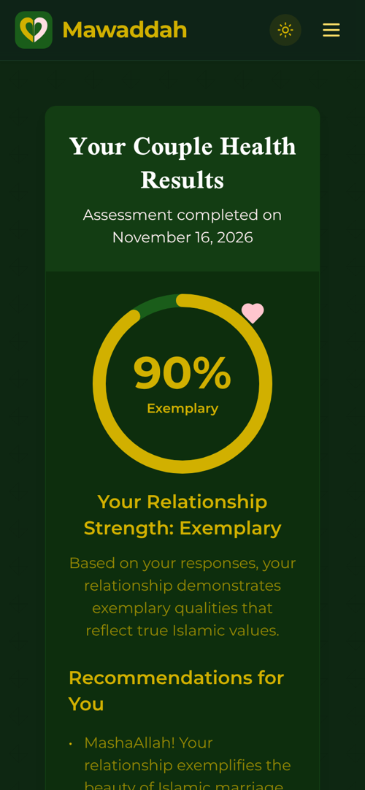
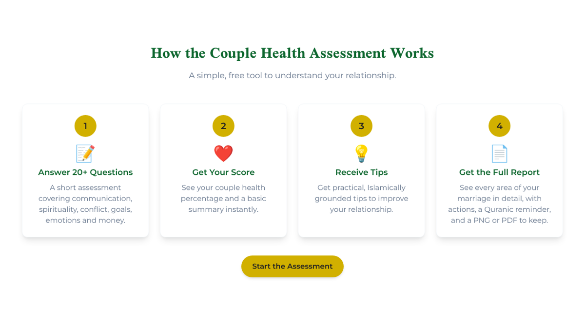

<div align="center">


# Mawaddah

**Nurture your love, Islamically.**

A free couple health assessment for Muslim couples. Answer a few honest questions and get a score, a full report on six areas of your marriage, and Islamic guidance you can download and keep. No sign up, and your answers never leave your browser.

[**Take the assessment**](https://mawaddah-beta.vercel.app/assessment) · [Report a bug](https://github.com/kolapoimam/mawaddah/issues/new?template=bug_report.yml) · [Request a feature](https://github.com/kolapoimam/mawaddah/issues/new?template=feature_request.yml) · [Contribute](CONTRIBUTING.md)


[](https://github.com/kolapoimam/mawaddah/actions/workflows/ci.yml)



</div>

> "And of His signs is that He created for you from yourselves mates that you may find tranquility in them; and He placed between you affection (mawaddah) and mercy (rahmah)." Quran 30:21

## Table of contents

- [Features](#features)
- [Screenshots](#screenshots)
- [Tech stack](#tech-stack)
- [Getting started](#getting-started)
- [Project structure](#project-structure)
- [How scoring works](#how-scoring-works)
- [SEO and AI discoverability](#seo-and-ai-discoverability)
- [Contributing](#contributing)
- [Roadmap](#roadmap)
- [Privacy](#privacy)
- [License](#license)

## Features

| | Feature | What it does |
| --- | --- | --- |
| 💞 | **Couple Health Assessment** | About 20 quick questions, one at a time, in around 5 minutes |
| 📊 | **Six area breakdown** | Communication, Spiritual Connection, Conflict Resolution, Shared Goals, Emotional Intimacy, Financial Harmony |
| 📄 | **Full report, free** | Insight and two practical steps for every area, plus a reminder from the Quran or Sunnah |
| 🎯 | **Where to start** | Highlights the area that needs the most care |
| 🖼️ | **Download your report** | Save a clean report as **PNG** or **PDF** |
| 📲 | **Share** | Copy a share message or send it to WhatsApp, X or Facebook |
| 🌙 | **Light and dark mode** | Follows your system, with a manual toggle |
| 🔒 | **Private by design** | No accounts, no database, no email needed |

## Screenshots

| Assessment | Results |
| --- | --- |
|  |  |

| Downloadable report | Mobile, dark mode |
| --- | --- |
|  |  |

| Home page |
| --- |
|  |

## Tech stack

| Area | Tools |
| --- | --- |
| Framework | [React 18](https://react.dev), [TypeScript](https://www.typescriptlang.org) and [Vite](https://vitejs.dev) |
| Styling | [Tailwind CSS](https://tailwindcss.com) and [shadcn/ui](https://ui.shadcn.com) |
| Fonts | Montserrat and Scheherazade New, self hosted with [Fontsource](https://fontsource.org) |
| Export | [html-to-image](https://github.com/bubkoo/html-to-image) for PNG, [jsPDF](https://github.com/parallax/jsPDF) for PDF |
| Avatars | [DiceBear](https://www.dicebear.com) (notionists), generated at build time |
| Photos | [Pexels](https://www.pexels.com) |
| Hosting | [Vercel](https://vercel.com) |

## Getting started

### Requirements

- Node.js 18 or newer
- npm

### Run it locally

```sh
git clone https://github.com/kolapoimam/mawaddah.git
cd mawaddah
npm install
npm run dev
```

Open http://localhost:8080 in your browser.

### Scripts

| Command | Description |
| --- | --- |
| `npm run dev` | Start the dev server with hot reload |
| `npm run build` | Build for production into `dist/` (also generates SEO files) |
| `npm run preview` | Preview the production build |
| `npm run lint` | Lint the code with ESLint |
| `npm run typecheck` | Check types with TypeScript |
| `npm run seo` | Regenerate `sitemap.xml`, `llms.txt` and `llms-full.txt` |
| `npm run avatars` | Regenerate the DiceBear testimonial avatars |

### Deploy

Mawaddah is a static site. Import the repo into Vercel, Netlify or Cloudflare Pages with build command `npm run build` and output folder `dist`. The included `vercel.json` handles clean URLs and client side routing.

## Project structure

```
src/
├── data/
│   ├── assessmentQuestions.ts   # Questions, answers and points
│   ├── categories.ts            # Six areas, guidance and reminders
│   ├── faq.ts                   # FAQ answers
│   ├── testimonials.ts          # Testimonials
│   └── images.ts                # Pexels photos with source links
├── components/
│   ├── assessment/              # Form, results page and downloadable report
│   ├── HeroCarousel.tsx         # Home page slider
│   ├── SafeImage.tsx            # Image with a solid colour fallback
│   └── ui/                      # shadcn/ui primitives
├── lib/
│   ├── scoring.ts               # Answers to scores
│   ├── exportReport.ts          # PNG and PDF export
│   └── site.ts                  # URLs and contact details
├── pages/                       # Home, Assessment, Results, About, FAQ, Contact, Privacy, 404
└── seo/routes.ts                # Page titles and descriptions
scripts/
├── seo-build.mjs                # Sitemap, llms files and prerendered pages
└── generate-avatars.mjs         # DiceBear avatars
```

## How scoring works

The first few questions describe you and your marriage (gender, years together, age group, children, living situation, income group). They help frame your answers and are **not scored**.

The other 16 questions are scored. Each answer earns 5, 3 or 1 points.

| Result | Overall score |
| --- | --- |
| Exemplary | 85% and above |
| Strong | 70% to 84% |
| Growing | 50% to 69% |
| Requires Attention | Below 50% |

Each of the six areas also gets its own percentage. In the full report an area is **Strong** at 80% and above, **Growing** from 60% to 79%, and **Needs care** below 60%. The guidance you see changes with the band.

Want to suggest a better question, score or reminder? Open a [content review](https://github.com/kolapoimam/mawaddah/issues/new?template=content_review.yml).

## SEO and AI discoverability

| What | Where |
| --- | --- |
| Titles, descriptions, canonical, Open Graph and X cards | `index.html` and `src/seo/routes.ts` |
| Structured data (WebSite, WebApplication, Quiz, FAQPage, BreadcrumbList) | `index.html` and `scripts/seo-build.mjs` |
| Prerendered HTML per page for crawlers without JavaScript | Generated into `dist/` after every build |
| `sitemap.xml`, `llms.txt` and `llms-full.txt` | Generated into `public/` before every build |
| `robots.txt` allowing search and AI crawlers | `public/robots.txt` |

Edit questions, guidance or FAQ answers in `src/data/` and everything above updates on the next build.

## Contributing

Contributions of every size are welcome.

1. Fork the repo and create a branch, for example `git checkout -b feat/hausa-translation`
2. Make your change and run `npm run lint` and `npm run build`
3. Commit with a clear message and push
4. Open a pull request using the template

Please read [CONTRIBUTING.md](CONTRIBUTING.md) for the full guide, and follow our [Code of Conduct](CODE_OF_CONDUCT.md).

Good places to start

- Issues labelled [`good first issue`](https://github.com/kolapoimam/mawaddah/labels/good%20first%20issue)
- Reviewing ayat and hadith references in `src/data/categories.ts`
- Accessibility and mobile improvements

## Roadmap

- [ ] Take the assessment as a couple and compare answers
- [ ] Verified Islamic counsellors
- [ ] Shared activity tracker with badges
- [ ] Islamic resource library on marriage
- [ ] Dua and reflection journal
- [ ] Translations (Arabic, Yoruba, Hausa, Urdu, French)
- [ ] Mobile app

Have an idea? [Open a feature request](https://github.com/kolapoimam/mawaddah/issues/new?template=feature_request.yml).

## Privacy

Mawaddah has no backend. Your answers stay in your browser tab and are gone when you close it. Reports are created on your device. The live site uses Vercel Web Analytics for anonymous page views only. Read the full [privacy policy](https://mawaddah-beta.vercel.app/privacy).

## Disclaimer

Mawaddah is a guidance tool. It does not replace advice from scholars, qualified counsellors or family elders. If your marriage is facing serious difficulty, please reach out to someone you trust.

## Credits

Photos from [Pexels](https://www.pexels.com). Avatars by [DiceBear](https://www.dicebear.com).

## License

Released under the [MIT License](LICENSE). Built by [Kolapo Imam](https://kolapo.ng).
